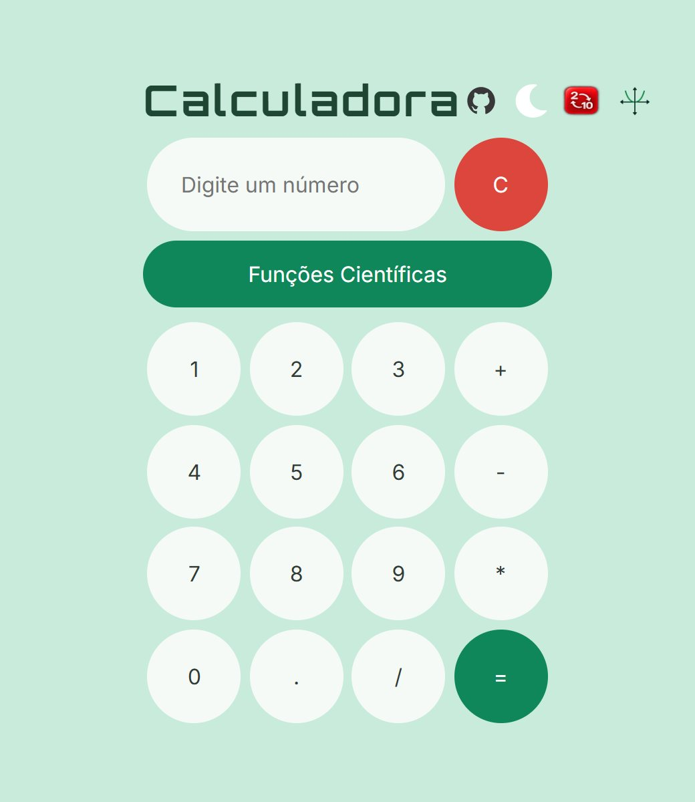
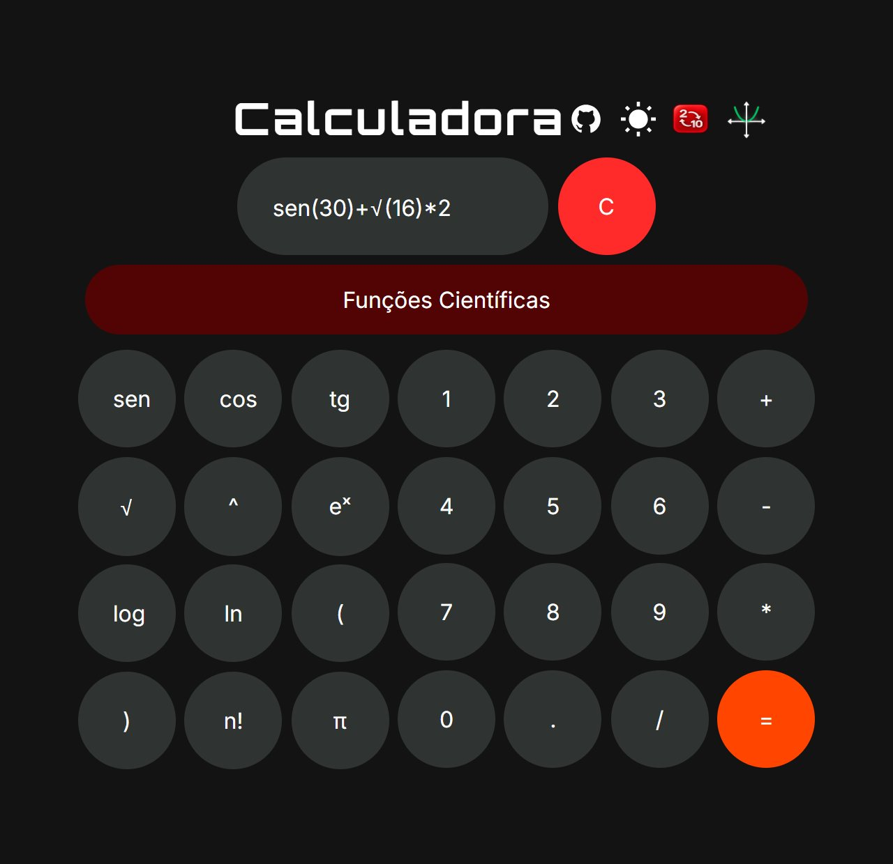
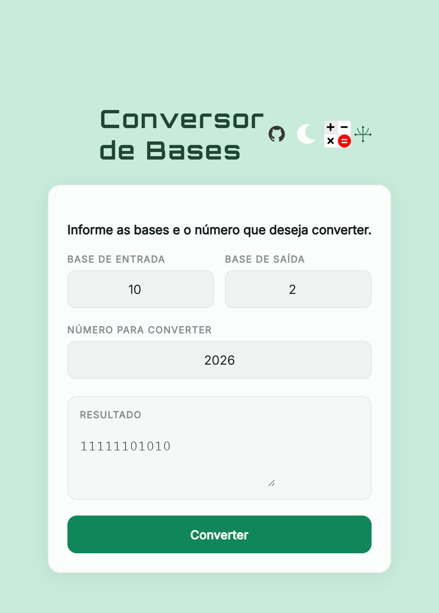
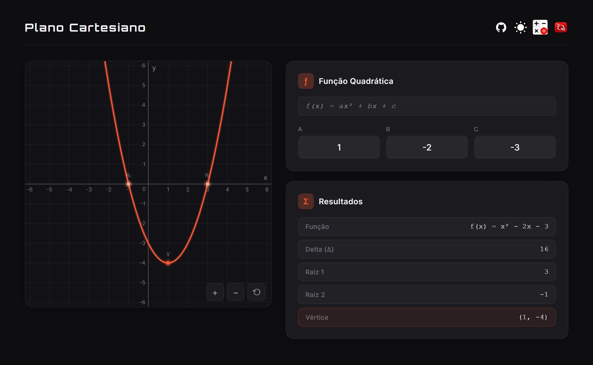
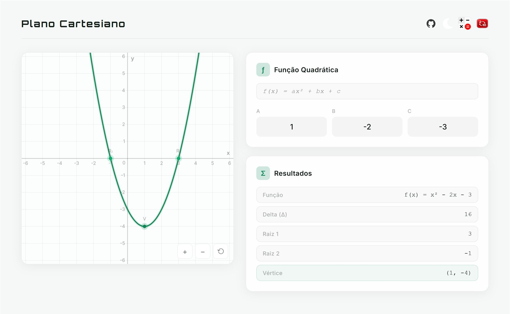

# 🧮 Calculadora Científica

Aplicação web com três ferramentas em telas integradas: **calculadora científica**, **conversor de bases numéricas** e **plano cartesiano** para funções do 2º grau. Tem modo escuro e claro, funciona direto no navegador e é feita com HTML, CSS e JavaScript puros, sem bibliotecas nem etapa de build.

Projeto Integrador II do curso de Análise e Desenvolvimento de Sistemas da Fatec Ribeirão Preto.

<p align="center">
  
  
  
  
</p>

<p align="center">
  
  &nbsp;&nbsp;&nbsp;
  
</p>

## ✨ Funcionalidades

### Calculadora científica

<p align="center">
  
</p>

- Operações básicas com parênteses: `+`, `-`, `*` e `/`.
- O botão **Funções Científicas** abre um painel com seno, cosseno e tangente (em **graus**), raiz quadrada, potência (`^`), `eˣ`, `log` (base 10), `ln`, fatorial (`n!`, inclusive de expressões entre parênteses, como `(2+3)!`) e `π`.
- Os números e operadores também podem ser digitados pelo teclado (veja os atalhos mais abaixo).
- O resultado aparece com 2 casas decimais. Expressões mal formadas mostram `Erro`, e contas sem resultado válido (divisão por zero, `ln(0)`, `√(-1)`) mostram `Resultado inválido`.

### Conversor de bases

<p align="center">
  
  &nbsp;&nbsp;&nbsp;
  
</p>

- Converte números inteiros entre quaisquer bases de **2 a 36**, com os dígitos `0–9` e as letras `A–Z`.
- Usa `BigInt`, então não há limite prático para o tamanho do número.
- Aceita números negativos (`-FF` na base 16 vira `-255` na base 10).
- Valida a entrada e explica o erro: base fora do intervalo, base não inteira, número fracionário ou caractere que não existe na base escolhida (informando os caracteres permitidos).

### Plano cartesiano

<p align="center">
  
</p>
<p align="center">
  
</p>

- Desenha `f(x) = ax² + bx + c` e atualiza o gráfico enquanto você digita os coeficientes.
- Calcula delta (Δ), as raízes (reais ou complexas) e o vértice, e marca raízes e vértice no gráfico.
- Também desenha retas (`a = 0`) e funções constantes (`a = 0` e `b = 0`).
- Tem zoom pelos botões `+`, `−` e `⟲` e fica nítido em telas de alta densidade.

### Tema claro e escuro

O botão de sol/lua alterna o tema. A escolha fica salva no navegador e vale para as três telas, que já abrem no último tema usado.

## ⌨️ Atalhos de teclado

Na tela da calculadora:

| Tecla | Ação |
|---|---|
| `0`–`9`, `.` | Digita números |
| `+` `-` `*` `/` | Operadores |
| `(` `)` | Parênteses |
| `^` | Potência |
| `!` | Fatorial |
| `Enter` | Calcula o resultado |
| `Backspace` | Apaga o último caractere |

As funções científicas (`sen`, `log`, `π` etc.) entram só pelos botões. Atalhos do navegador com `Ctrl`, `Alt` ou `Cmd`, como o zoom (`Ctrl` + `-`), continuam funcionando.

## 🚀 Como usar

Não há nada para instalar.

1. Clone o repositório (ou baixe o ZIP pelo botão **Code** do GitHub):
   ```bash
   git clone https://github.com/guilhermeperecim-jpg/Projeto-Calculadora-Cient-fica.git
   ```
2. Abra o arquivo `index.html` no navegador.
3. Use os ícones do topo para ir ao conversor de bases e ao plano cartesiano.

As fontes (Inter e Orbitron) vêm do Google Fonts. Sem internet, o navegador usa fontes padrão e todo o resto funciona normalmente.

## 🗂️ Estrutura do projeto

```
├── index.html                 # Calculadora científica
├── conversor/
│   └── tela_bases.html        # Conversor de bases
├── plano/
│   ├── tela_plano.html        # Plano cartesiano
│   ├── plano.css              # Estilos do plano
│   └── plano.js               # Gráfico (canvas) e cálculos do plano
├── scripts/
│   └── script.js              # Calculadora, conversor e troca de tema
├── styles/
│   └── style.css              # Estilos da calculadora e do conversor
├── assets/                    # Ícones e capturas de tela
├── DOCUMENTACAO.md            # Documentação técnica
└── README.md
```

## 🛠️ Tecnologias

- **HTML5** para a estrutura das três telas.
- **CSS3** com variáveis CSS e temas alternados por classe (`.light` / `.dark`).
- **JavaScript** puro, com a **Canvas API** (gráfico), **BigInt** (conversor) e **localStorage** (tema salvo).
- **Google Fonts**: Inter e Orbitron.

## 📄 Documentação

O arquivo [DOCUMENTACAO.md](./DOCUMENTACAO.md) descreve cada tela, função e arquivo do projeto. Ele também registra os problemas encontrados durante o desenvolvimento, com número e situação (resolvido ou em aberto).

## ⚠️ Limitações conhecidas

- A calculadora avalia as expressões com `eval`, então segue a sintaxe do JavaScript: `-2^2` dá erro e a multiplicação implícita (`2sen(30)`) não é aceita. Use `-(2^2)` e `2*sen(30)`.
- Como o resultado é arredondado para 2 casas decimais, valores muito pequenos aparecem como `0.00`.
- A constante `e` não tem botão próprio (só aparece dentro de `eˣ`).

A lista completa está na seção "Bugs e pontos em aberto" da [documentação](./DOCUMENTACAO.md#bugs-e-pontos-em-aberto).

## 🤝 Créditos

Baseado no projeto de código aberto [zxcodes/Calculator](https://github.com/zxcodes/Calculator), de Mohammed Farmaan. A equipe traduziu a calculadora para o português e acrescentou as funções científicas, o conversor de bases, o plano cartesiano, o tema salvo entre telas e a documentação técnica.

## 👥 Desenvolvedores

<table>
  <tr>
    <td align="center">
      <a href="https://github.com/guilhermeperecim-jpg">
        <br>
        <sub><b>Guilherme Perecim</b></sub>
      </a>
    </td>
    <td align="center">
      <a href="https://github.com/GabrielPerecim">
        <br>
        <sub><b>Gabriel Perecim</b></sub>
      </a>
    </td>
    <td align="center">
      <a href="https://github.com/cap0606">
        <br>
        <sub><b>Vinícius Luiz Apolaro</b></sub>
      </a>
    </td>
    <td align="center">
      <a href="https://github.com/Luc-C-2">
        <br>
        <sub><b>Lucas Bernardo Menezes</b></sub>
      </a>
    </td>
    <td align="center">
      <a href="https://github.com/murilobonuti">
        <br>
        <sub><b>Murilo Bonuti</b></sub>
      </a>
    </td>
  </tr>
</table>
